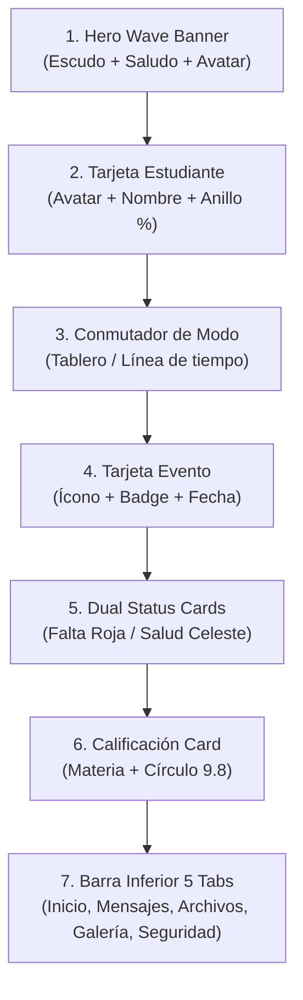

# 🎨 Guía de Diseño y Sistema de Diseño UI (Design System)
## Plataforma Escolar — Instituto República de Italia (Entre Ríos)

Este documento contiene todas las especificaciones de diseño, paleta de colores, tipografía, componentes, espaciados, sombras y mapas de pantallas para recrear o prototipar la interfaz en aplicaciones externas como **Figma**, **Penpot**, **Sketch** o **Adobe XD**.

---

## 1. Identidad Institucional y Concepto de Marca

- **Institución:** Instituto República de Italia
- **Ubicación:** Entre Ríos, Argentina
- **Concepto Visual:** Armonía y lazo cultural entre la identidad italiana (Verde Italia `#008C45`, Rojo Italia `#CD212A`) y la argentina (Celeste `#3898EC`, Blanco Puro `#FFFFFF`), enmarcados por un contorno plateado metálico contemporáneo.
- **Tono de Comunicación:** Amigable, cálido, protector para las familias, moderno y con jerarquía clara de información (no recargado ni plano).

---

## 2. Paleta de Colores Oficial (Color Tokens)

### 2.1. Colores Primarios e Identidad
| Token | Valor Hex | RGB | Uso Recomendado |
| :--- | :--- | :--- | :--- |
| `primary` | **`#008C45`** | `rgb(0, 140, 69)` | **Verde Italia Oficial:** Botones primarios, cabeceras curvas (hero wave), pestañas activas, bordes destacados. |
| `primary-dark` | **`#005F2E`** | `rgb(0, 95, 46)` | Estados hover/pressed, textos sobre verde suave, sombras de cabecera. |
| `primary-light` | **`#E8F7EE`** | `rgb(232, 247, 238)` | Fondos de tarjetas seleccionadas, pills de éxito, círculos de avatar. |
| `primary-gradient` | `linear-gradient(135deg, #009A4D 0%, #007037 100%)` | — | Degradado opcional para hero banners y portadas destacadas. |

### 2.2. Colores Secundarios y Enlace Cultural
| Token | Valor Hex | RGB | Uso Recomendado |
| :--- | :--- | :--- | :--- |
| `celeste` | **`#3898EC`** | `rgb(56, 152, 236)` | **Celeste Argentina:** Píldoras de eventos, enlaces interactivos, citas escolares, gráficas. |
| `celeste-dark` | **`#1A73E8`** | `rgb(26, 115, 232)` | Textos sobre celeste claro, iconos de acción secundaria. |
| `celeste-light` | **`#EFF6FF`** | `rgb(239, 246, 255)` | Fondos de tarjetas de salud, avisos de secretaría, píldoras informativas. |
| `celeste-border`| **`#BAE6FD`** | `rgb(186, 230, 253)` | Borde de tarjetas en tonalidad celeste. |

### 2.3. Acentos de Alerta y Notificaciones
| Token | Valor Hex | RGB | Uso Recomendado |
| :--- | :--- | :--- | :--- |
| `accent-red` | **`#CD212A`** | `rgb(205, 33, 42)` | **Rojo Bandera Italia:** Globos de notificación no leída (badges), alertas críticas, inasistencias. |
| `accent-red-light` | **`#FFF1F2`** | `rgb(255, 241, 242)` | Fondo de tarjetas de inasistencia o faltas en "¿Qué ha pasado?". |
| `accent-red-border`| **`#FECDD3`** | `rgb(254, 205, 211)` | Bordes de tarjetas de falta y tardanzas. |
| `accent-red-text` | **`#9F1239`** | `rgb(159, 18, 57)` | Títulos y etiquetas de falta de asistencia. |

### 2.4. Superficies y Neutros
| Token | Valor Hex | RGB | Uso Recomendado |
| :--- | :--- | :--- | :--- |
| `bg-screen` | **`#F4F7FC`** | `rgb(244, 247, 252)` | Fondo global de la aplicación (gris azulado muy suave, no cansa la vista). |
| `card-bg` | **`#FFFFFF`** | `rgb(255, 255, 255)` | Fondo de tarjetas elevadas flotantes, modales y barras de navegación. |
| `border-default`| **`#E2E8F0`** | `rgb(226, 232, 240)` | Bordes sutiles de separación entre módulos. |
| `silver-metal` | **`#9CA3AF`** | `rgb(156, 163, 175)` | Borde plateado del escudo, iconos inactivos, subtítulos tenues. |
| `text-primary` | **`#0F172A`** | `rgb(15, 23, 42)` | Títulos principales, nombres y datos clave (alto contraste). |
| `text-secondary`| **`#475569`** | `rgb(71, 85, 105)` | Textos descriptivos, roles, fragmentos de mensajes. |
| `text-muted` | **`#94A3B8`** | `rgb(148, 163, 184)` | Fechas secundarias, placeholders y marcas temporales. |

---

## 3. Tipografía y Jerarquía Textual

Familia sugerida: **Inter**, **SF Pro Display / Text** (iOS) o **Roboto** (Android).

| Nivel Jerárquico | Tamaño (Size) | Peso (Weight) | Altura de Línea (Line Height) | Espaciado (Tracking) | Uso |
| :--- | :--- | :--- | :--- | :--- | :--- |
| **Hero Title** | 22 px | Bold (800) | 28 px | -0.4 px | Títulos de pantallas en banners curvos (*Comunicaciones*, *Archivos*). |
| **Section Title**| 17 px | Bold (800) | 22 px | -0.3 px | Encabezados de bloques (*Próximos eventos*, *¿Qué ha pasado?*). |
| **Card Title** | 15 - 16 px | Bold (700 / 800) | 20 px | -0.2 px | Nombres de alumnos, títulos de eventos, remitentes. |
| **Body Large** | 14 px | Regular (400) / Semi (600) | 20 px | 0 | Textos de mensajes, descripciones de eventos. |
| **Body Small** | 12 - 13 px | Regular (400) / Medium (500) | 18 px | 0 | Subtítulos de cursos, roles docentes, extractos de archivos. |
| **Badge / Pill** | 10 - 11 px | ExtraBold (800 / 900) | 14 px | +0.5 px | Píldoras en mayúsculas (*CELEBRACIÓN*, *CITA COLEGIO*, *Tardanza*). |
| **Microcopy** | 9 - 10 px | Bold (700) | 12 px | 0 | Indicadores de calificación (*Sobresaliente*, */ 10*). |

---

## 4. Radios de Esquinas (Border Radius) y Sombras

### 4.1. Radios de Esquina
- **Small (8 - 10 px):** Píldoras de categoría, badges de estado, tags internos.
- **Medium (14 - 16 px):** Iconos en caja, campos de texto, avatares de estudiantes en tarjetas.
- **Large (20 - 24 px):** Tarjetas de eventos, tarjetas de estado ("¿Qué ha pasado?"), modales y carrusel de estudiantes.
- **Curved Hero Wave (32 px):** Esquinas inferiores izquierda y derecha de la ola curva superior (`borderBottomLeftRadius: 32`, `borderBottomRightRadius: 32`).
- **Pill / Circular (999 px):** Botones flotantes (FAB), avatares circulares de docentes, anillos de porcentaje.

### 4.2. Sombras y Elevaciones (Elevations)
- **Elevación 1 (Sutil):**
  - Figma: `Drop Shadow: X: 0, Y: 2, Blur: 4, Spread: 0, Color: rgba(15, 23, 42, 0.04)`
- **Elevación 2 (Tarjetas estándar):**
  - Figma: `Drop Shadow: X: 0, Y: 4, Blur: 10, Spread: 0, Color: rgba(15, 23, 42, 0.06)`
- **Elevación 3 (Banners y tarjetas activas):**
  - Figma: `Drop Shadow: X: 0, Y: 6, Blur: 14, Spread: 0, Color: rgba(0, 140, 69, 0.18)`
- **Elevación 4 (Botón flotante FAB):**
  - Figma: `Drop Shadow: X: 0, Y: 8, Blur: 16, Spread: 0, Color: rgba(0, 140, 69, 0.35)`

---

## 5. Biblioteca de Componentes UI (Design System Components)

### Componente 1: Hero Wave Banner (Ola Curva Superior)
- **Dimensiones:** Ancho `100%`, Alto `~180px`, fondo `#008C45`.
- **Borde inferior:** Curvatura pronunciada en esquinas inferiores (`radius: 32px`).
- **Contenido:**
  - Izquierda: Escudo oficial circular con borde blanco de 2px, Nombre institucional en blanco (*Instituto República de Italia*), y subtítulo en verde claro (*Entre Ríos · Ciclo 2026*).
  - Derecha: Avatar circular del tutor con borde translúcido (`rgba(255,255,255,0.25)`).
  - Texto inferior: *"Hola, Familia López 👋"* en tamaño 20px negrita, y *"Viendo información de Mateo"* con nombre subrayado.

### Componente 2: Tarjeta de Estudiante (StudentCarousel)
- **Dimensiones:** Ancho responsivo (`~260 - 280px`), Alto `~84px`, fondo blanco con radio de 22px.
- **Avatar Izquierdo:** Caja de 58x58px con esquinas redondeadas de 18px, fondo temático e indicador verde de actividad en esquina inferior.
- **Información:**
  - Nombre en negrita de 16px.
  - **Anillo de Puntaje Circular (Derecha):** Círculo de 36x36px con borde de 2.5px que muestra el porcentaje de regularidad/asistencia (`96%`, `88%`).
  - Subtítulo de sala/curso en gris oscuro.
  - Píldora de nivel educativo (*Nivel Inicial*, *Primaria*).
- **Estado Seleccionado:** Borde verde institucional `#008C45` de 2px y sombra con leve resplandor verde.

### Componente 3: Conmutador de Modo (Tablero / Línea de Tiempo)
- **Contenedor:** Cápsula gris suave `#E2E8F0` con radio de 24px y padding de 3px.
- **Botón Activo:** Píldora verde `#008C45` con texto blanco negrita y sombra suave.
- **Botón Inactivo:** Fondo transparente con texto gris azulado.

### Componente 4: Tarjeta de Evento Importante
- **Dimensiones:** Ancho `~280px`, radio de 22px.
- **Fondo:** Amarillo pastel suave `#FEF9C3` con borde `#FDE047` (para celebraciones) o Celeste hielo `#F0F9FF` con borde `#BAE6FD` (para citas escolares).
- **Encabezado:** Caja de icono de 40x40px + Píldora de categoría en mayúsculas negrita (`CELEBRACIÓN` o `CITA COLEGIO`).
- **Título & Descripción:** 2 líneas legibles.
- **Píldora Flotante de Fecha:** Fondo blanco sólido con esquinas de 14px y texto en negrita: `📅 Viernes, 06 Noviembre`.

### Componente 5: Tarjetas Gemelas "¿Qué ha pasado?" (Dual Status Cards)
- **Disposición:** 2 columnas responsivas (50% / 50% con gap de 12px).
- **Tarjeta 1 (Inasistencias):**
  - Fondo: Rojo pastel suave `#FFF1F2`, borde `#FECDD3`.
  - Título: *"Falta de asistencia"*, subtítulo de fecha (*Vie, 28 Octubre*).
  - Botón píldora inferior: Fondo blanco sólido con texto rojo: `Tardanza (1/4)`.
- **Tarjeta 2 (Salud / Ficha Médica):**
  - Fondo: Celeste suave `#EFF6FF`, borde `#BFDBFE`.
  - Título: *"Fiebre / Consulta"*, subtítulo de fecha (*Vie, 24 Octubre*).
  - Botón píldora inferior: Fondo blanco sólido con texto azul: `Justificada ✓`.

### Componente 6: Calificación Destacada
- **Contenedor:** Ficha blanca de 20px de radio con borde suave.
- **Izquierda:** Contenedor temático de icono (48x48px con fondo verde suave e icono italiano `🇮🇹`), Asignatura (*Lengua y Cultura Italiana*), y Detalle del examen.
- **Derecha:** Círculo grande de 56x56px con borde verde `#008C45` que muestra la nota en tipografía 17px negrita (`9.8`) y etiqueta inferior (`/ 10`).

### Componente 7: Barra de Navegación Inferior (Bottom Tab Bar)
- **Dimensiones:** Altura de 62px, fondo blanco sólido, esquinas superiores ligeramente curvadas y línea divisoria `#E2E8F0`.
- **5 Pestañas:**
  1. 🏠 **Inicio:** Vista general y tablero.
  2. 💬 **Mensajes:** Con badge circular rojo de mensajes no leídos (`3`).
  3. 📁 **Archivos:** Documentos, carpetas y descargas.
  4. 🖼️ **Galería:** Álbumes de fotos y recuerdos.
  5. 🛡️ **Seguridad:** Padrón de retiros en puerta y autorizaciones eventuales.

---

## 6. Mapas de Pantallas (Artboards / Wireframes de Figma)

### Artboard 1: `Mobile / 01_Home_Dashboard`
- **Cabecera:** Hero Wave verde con logo y saludo familiar.
- **Sección 1:** Estudiantes a cargo (Carrusel deslizable horizontalmente con Mateo y Sofía).
- **Sección 2:** Selector de modo en `Tablero`.
- **Sección 3:** Carrusel de Próximos eventos importantes (Cumpleaños y Citas).
- **Sección 4:** Bloque "¿Qué ha pasado?" con tarjetas gemelas roja y celeste.
- **Sección 5:** Calificaciones recientes con tarjeta de Lengua Italiana (`9.8`).
- **Sección 6:** Galería de Actividades (Vistas previas de Arte, Deportes, Huerta).
- **Navegación:** Tab Bar fijo en la parte inferior con Inicio seleccionado.

### Artboard 2: `Mobile / 02_Home_Timeline_Jardin`
- **Misma cabecera y carrusel de estudiantes** con Mateo (Sala de 4 - Jardín) activo.
- **Selector de modo en `Línea de tiempo`**.
- **Timeline de rutina:**
  - 08:00 hs — Entrada al aula (Tag: *😊 Alegre y participativo*).
  - 10:15 hs — Colación de media mañana (Tag: *⭐ Comió TODO*).
  - 12:30 hs — Mudas de pañal e higiene (Tag: *💧 Pañal cambiado*).
  - 13:00 - 14:15 hs — Siesta y descanso.

### Artboard 3: `Mobile / 03_Comunicaciones`
- **Cabecera:** Hero Wave verde con título *"Comunicaciones"* y subtítulo.
- **Buscador:** Barra blanca flotante superpuesta a la ola curva con lupa.
- **Filtros:** Píldoras horizontales `[ Recibidos (3) ]`, `[ Enviados ]`, `[ Papelera ]`.
- **Lista de Hilos:**
  - Ana Martínez (Punto verde online, asunto, extracto, hora *12:45 PM*, globo rojo *2*).
  - Carlos Gómez (Punto celeste, asunto de Educación Física, globo rojo *1*).
  - Gabinete Psicopedagógico (Punto ámbar, seguimiento de evolución).
  - Secretaría (Vencimiento de Apto Físico).
- **Botón Flotante:** Botón circular verde con icono `✏️` en esquina inferior derecha.

### Artboard 4: `Mobile / 04_Archivos_Documentos`
- **Cabecera:** Hero Wave verde con título *"Archivos"* y subtítulo.
- **Conmutador:** Pestañas `[ Recientes ]` y `[ Carpetas ]`.
- **Bloques agrupados:**
  - *Hoy:* Carpeta de Grado (`📁`), Reglamento Institucional 2026 (`📄 PDF - 1.8 MB`).
  - *Esta semana:* Actividades Psicomotricidad (`📄`), Permiso Salida Temaikèn (`📄`).
  - *Este mes:* Lista de Materiales (`📝 DOC`), Boletín Informativo (`📄`).
- Cada fila cuenta con botón circular de descarga rápida (`↓`).

### Artboard 5: `Mobile / 05_Galeria_Pedagogica`
- **Cabecera:** Hero Wave verde con título *"Galería de Actividades"*.
- **Píldoras de Categoría:** `[ TODAS ]`, `[ JARDÍN ]`, `[ ARTE ]`, `[ DEPORTES ]`, `[ SALIDAS ]`.
- **Tarjetas de Álbum:**
  - Portada visual con emoji grande e indicador flotante de fotos (`📷 18 fotos`).
  - Cuerpo: Categoría en verde suave, fecha y descripción pedagógica.

### Artboard 6: `Mobile / 06_Seguridad_Puerta_Pickup`
- **Cabecera:** Hero Wave verde con título *"Retiros Seguros"*.
- **Aviso Informativo:** Recuadro azul con escudo de seguridad física.
- **Padrón Permanente:**
  - Mariana López (Madre - Permanente).
  - Clara Domínguez (Abuela - Permanente).
- **Botón de Acción:** `+ Autorizar Retiro por Hoy`.
- **Modal de Autorización Eventual:** Formulario para ingresar Nombre, DNI y Parentesco de la persona autorizada con advertencia legal.

### Artboard 7: `Mobile / 07_Firma_Digital_PIN`
- **Modal Oscuro Flotante:**
  - Título: *"Confirmación Digital con PIN"*.
  - Detalle: Autorización de Salida Educativa al Bioparque Temaikèn.
  - Campo de Entrada: 6 casillas o campo numérico de 6 dígitos con formato `••••••`.
  - Botones: `Cancelar` y `Autorizar con PIN` (Verde Institucional).

---

## 7. Instrucciones para Importar a Figma o Herramientas Externas

1. **Configurar Cuadrícula Base (Grid 8pt):**
   - Espaciados estándar: `4px`, `8px`, `12px`, `16px`, `20px`, `24px`, `32px`.
2. **Definir Estilos de Color (Color Styles):**
   - Crear carpetas en Figma: `Brand/Verde Italia`, `Brand/Celeste`, `Brand/Rojo Italia`, `Neutral/Background`, `Neutral/Text`.
3. **Definir Estilos de Texto (Text Styles):**
   - Crear estilos según la tabla de la Sección 3 con fuente **Inter** o **SF Pro**.
4. **Vectores y Recursos:**
   - Ubicación del escudo oficial: [`apps/mobile/assets/logo-colegio.png`](file:///c:/Users/Pc/Desktop/BiliAPP/apps/mobile/assets/logo-colegio.png).

